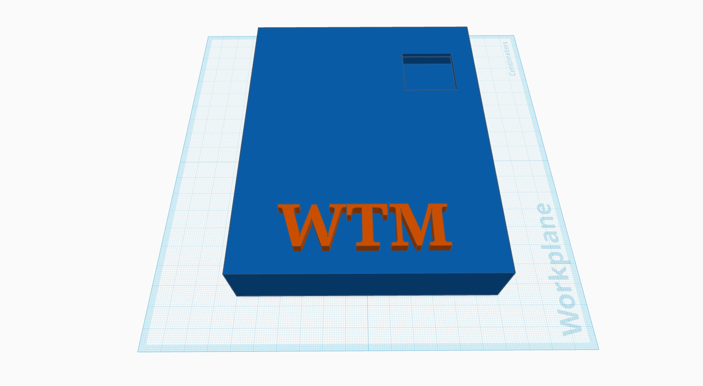
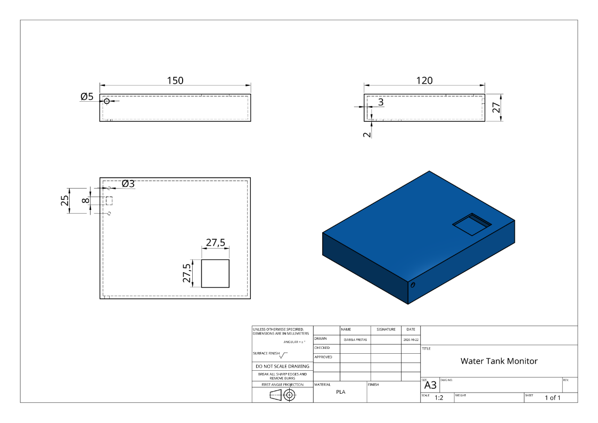

<div align="center">

# 💧 Water Tank Monitor

**Acompanhe parâmetros da água no display e no navegador, usando um ESP32.**


[](LICENSE)

[Comece aqui](docs/COMECE_AQUI.md) · [Entenda o código](docs/COMO_O_CODIGO_FUNCIONA.md) · [Circuito](hardware/README.md) · [Frame](#frame) · [Equipe](#equipe)

</div>

## Sobre o projeto

O Water Tank Monitor é um projeto acadêmico para acompanhar **pH, turbidez, condutividade elétrica (EC) e temperatura**. A proposta é facilitar a observação de mudanças na água e apoiar a inspeção de reservatórios. O ESP32 coleta os sinais, mostra as informações no OLED e cria uma rede Wi-Fi para consultar o painel pelo celular ou computador.

O protótipo já permite testar painel, display e sinais de três potenciômetros. A calibração e a precisão dos sensores reais ainda precisam de ensaios. **O projeto não confirma a potabilidade da água** nem está validado para instalação residencial permanente.

## Por onde começar

| Quero… | Guia |
|---|---|
| Baixar, instalar e montar minha primeira bancada | **[Comece aqui: passo a passo](docs/COMECE_AQUI.md)** |
| Entender cada arquivo e a lógica por trás do programa | **[Como o código funciona](docs/COMO_O_CODIGO_FUNCIONA.md)** |
| Conferir fios, alimentação e componentes | [Projeto elétrico](hardware/README.md) e [lista de materiais](hardware/bom.csv) |
| Usar o site, o OLED, gráficos e PDF | [Manual do painel](docs/PAINEL.md) |
| Calibrar e operar sensores reais | [Operação e calibração](docs/OPERACAO.md) |
| Saber por que cada ferramenta foi escolhida | [Decisões técnicas](docs/DECISOES.md) |
| Reproduzir testes e conhecer limitações | [Testes e resultados](docs/TESTES.md) |
| Experimentar a demonstração virtual | [Guia Wokwi](simulation/wokwi/README.md) |

## O que já está implementado

- **Painel local com tema claro e escuro**, sem aplicativo ou internet.
- **OLED com quatro formatos fixos:** lista, grade, destaque e gráfico de um parâmetro, escolhidos pelo site.
- **Gráficos recentes no site e no OLED**, com até 48 leituras, aproximadamente quatro minutos.
- **Três canais simulados por potenciômetros**, sempre identificados como SIM: pH, turbidez e EC. Temperatura continua sendo lida pelo DS18B20.
- **Calibração guiada:** captura automática após estabilidade, dois pontos e verificação por terceira referência.
- **Histórico de médias por minuto**, com capacidade de até 24 horas, e download de **relatório PDF** com gráficos e tabelas.
- **Preferências persistentes:** senha, tema, formato do OLED, simulação e calibrações sobrevivem ao desligamento.
- **Estados explícitos:** leitura atual, antiga, simulada, indisponível ou com calibração pendente.

O histórico e os pontos dos gráficos ficam em memória temporária: reiniciar a placa os apaga. Alterar modo/calibração também limpa as séries. A coleta continua enquanto há energia, mesmo com o navegador fechado.

## Como funciona, em poucas palavras

```text
Sensores ou potenciômetros
           ↓
ESP32 lê, interpreta e identifica o estado dos dados
           ├── OLED: valores ou gráfico
           ├── Memória: leituras recentes e médias por minuto
           └── Wi-Fi local → navegador → painel e relatório PDF
```

O firmware em C/C++ controla a placa. HTML, CSS e JavaScript formam o site, que é enviado pelo próprio ESP32. O navegador desenha os gráficos e gera o PDF; não há servidor externo ou serviço de nuvem.

| Parâmetro | Significado | Situação na bancada com potenciômetros |
|---|---|---|
| pH | Acidez ou alcalinidade. | Valor sintético de 0 a 14. |
| Turbidez | Alterações associadas a partículas em suspensão. | Indicador relativo de 0 a 100%; não é NTU calibrada. |
| EC | Condutividade relacionada a íons dissolvidos. | Valor sintético de 0 a 2000 µS/cm. |
| Temperatura | Condição térmica da amostra. | Valor real do DS18B20; sem sensor válido, fica indisponível. |

Para medições reais, pH e EC usam sessões de amostra; EC exige temperatura de 25 ±0,5 °C. Referências físicas e verificação da montagem são necessárias antes de interpretar os resultados.

## Instalação resumida

1. Baixe o ZIP em **Code → Download ZIP**, extraia e instale a [Arduino IDE](https://www.arduino.cc/en/software).
2. Instale **esp32 by Espressif Systems 2.0.17** e as bibliotecas da tabela abaixo. Essa é a referência testada, não a versão mais recente.
3. Abra [`firmware/WaterTankMonitor/WaterTankMonitor.ino`](firmware/WaterTankMonitor/WaterTankMonitor.ino), mantendo os arquivos `.h` na mesma pasta.
4. Selecione **ESP32 Dev Module** e a porta USB, compile e carregue o firmware.
5. No Monitor Serial a **115200 baud**, envie `rede` para consultar senha e IP.
6. Conecte à rede **WaterTankMonitor** e abra **http://192.168.4.1**. Informe a senha no painel para alterar configurações.

O [guia completo](docs/COMECE_AQUI.md) explica cada clique, download, ligação e primeiro teste. Para obter pelo Git:

```bash
git clone https://github.com/Jvscopel27/Water-Tank-monitor.git
cd Water-Tank-monitor
```

## Tecnologias e componentes

O ambiente principal é **Arduino IDE 2.x**, com Arduino Core para ESP32. `Wire`, `WiFi`, `WebServer` e `Preferences` já vêm no pacote da placa. Instale as cinco bibliotecas externas pelo Gerenciador de Bibliotecas:

| Biblioteca | Versão de referência | Função |
|---|---|---|
| Adafruit GFX Library | 1.12.6 | Textos, formas e gráficos. |
| Adafruit SSD1306 | 2.5.16 | Controle do OLED. |
| Adafruit BusIO | 1.17.4 | Comunicação usada pelas bibliotecas Adafruit. |
| OneWire | 2.3.8 | Protocolo do DS18B20. |
| DallasTemperature | 4.0.6 | Leitura de temperatura. |

| Componente | Conexão principal |
|---|---|
| ESP32-WROOM-32 DevKit | Controlador e Wi-Fi. |
| OLED SSD1306 I²C 0,96", 128 × 64 | SDA 21, SCL 22, alimentação 3V3/GND. |
| DS18B20 de três fios | GPIO 4, com pull-up de 4,7 kΩ. |
| PH4502C com eletrodo BNC | GPIO 35, com adequação elétrica. |
| Módulo de turbidez analógico, 5 V | GPIO 34, com adequação elétrica. |
| TDS V1.0 com sonda | GPIO 32; estimativa experimental de EC. |
| Três potenciômetros para os testes | Centrais em 35/34/32; laterais em 3V3 e GND. |

**Não aplique 5 V nos GPIOs.** Monte com a alimentação desligada e confira o [circuito de referência](hardware/README.md), divisores e tensões antes de substituir potenciômetros por sensores. O título comercial do módulo não garante a pinagem da unidade recebida.

### Demonstração virtual


A demonstração Wokwi usa um sketch separado para ilustrar entradas, OLED e falhas. Ela não contém todo o painel do firmware de bancada nem valida sensores reais. Siga o [guia da simulação](simulation/wokwi/README.md).

## Testes e próximos passos

Foram registrados testes de compilação, lógica de medições, painel em navegador, geração de PDF e bancada com ESP32/OLED/potenciômetros. As verificações incluem gráficos, preferências após reinício, cancelamento da captura automática e identificação de dados simulados. Consulte as condições e os resultados no [registro de testes](docs/TESTES.md).

Ainda são necessários ensaios com sondas e referências físicas, avaliação de precisão, interferências, operação por 24 horas e validação mecânica/elétrica da instalação. A existência de uma funcionalidade no código não significa que a medição física já foi validada.


## Frame



## Como contribuir

Contribuições para a documentação, implementação e validação são bem-vindas.

1. Abra uma [issue](https://github.com/Jvscopel27/Water-Tank-monitor/issues) descrevendo a proposta ou o problema encontrado.
2. Faça um fork do repositório e crie uma branch para a alteração:

   ```bash
   git switch -c melhoria/descricao-da-alteracao
   ```

3. Faça as alterações e atualize a documentação relacionada.
4. Verifique o que for aplicável. Em mudanças de hardware ou medições, informe a montagem, as condições e os resultados dos ensaios.
5. Abra um pull request com o objetivo da mudança, o que foi alterado e como foi verificado.

Ao registrar resultados, identifique claramente dados simulados, leituras reais e medições ainda não validadas.

## Equipe

| Integrante | Contato |
| :--- | :--- |
| João Vitor Scopel | [GitHub — @Jvscopel27](https://github.com/Jvscopel27) |
| Isabela Freitas | [GitHub — @isabelafreitas123-ufes](https://github.com/isabelafreitas123-ufes) |
| Davi Saad | [GitHub — @davisaad-bot](https://github.com/davisaad-bot) |

Para dúvidas sobre o projeto, utilize as [issues do repositório](https://github.com/Jvscopel27/Water-Tank-monitor/issues).

## Licença

Este projeto está licenciado sob a **Licença MIT**. Consulte o arquivo [LICENSE](LICENSE) para conhecer os termos.
