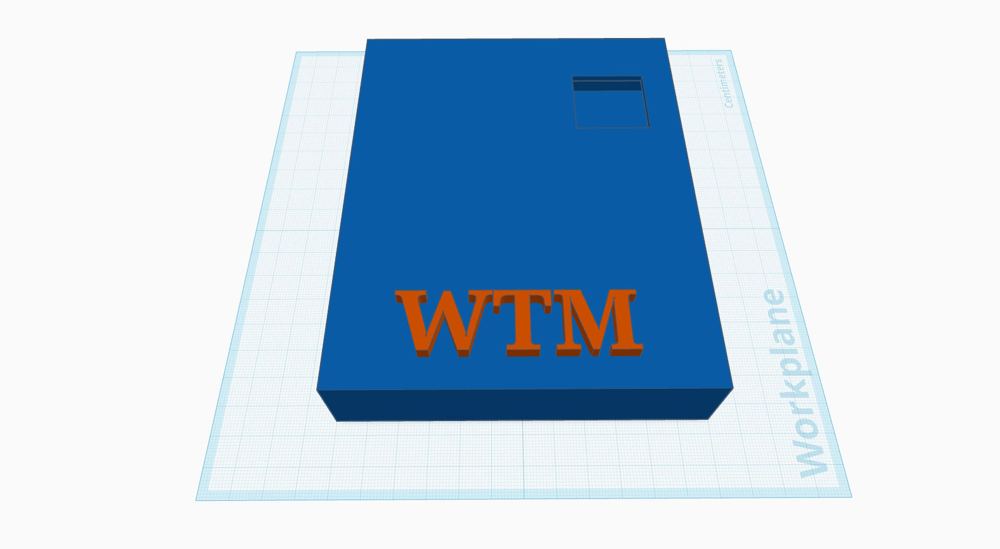
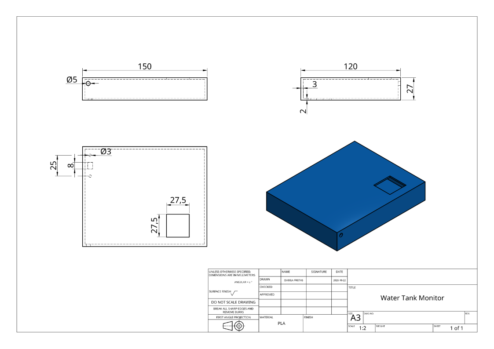

# 💧 Water Tank Monitor

Protótipo com ESP32 para acompanhar **pH, turbidez relativa (%) e condutividade (µS/cm)** no navegador e no OLED. O ESP32 cria sua própria rede Wi-Fi; não precisa de internet para medir ou abrir o painel.

**Comece pelo [guia de montagem e primeira leitura](docs/COMECE_AQUI.md).** Não é necessário saber Git: use **Code → Download ZIP** nesta página.

## Estado atual — 21/11/2026

- Três sensores analógicos reais: pH no GPIO 35, turbidez no GPIO 34, condutividade no GPIO 32.
- Temperatura retirada do firmware, site, OLED e relatório. Condutividade permanece em **µS/cm**, sem compensação térmica e sem exigir DS18B20.
- Aquisição a cada 5 segundos, contínua desde a inicialização. Desconectar uma sonda não interrompe os outros canais. Sinais inválidos continuam visíveis em mV; valores válidos retornam automaticamente.
- pH com suporte a dois ou três pontos; turbidez e condutividade com curva de dois pontos. Configurações e calibrações persistem após desligar.
- Gráfico de linhas, último valor e variação; histórico de médias por minuto em RAM (até 24 horas) e relatório PDF local.
- Calibrações experimentais da bancada em [calibration/](calibration/README.md). **Os números desta bancada não são uma calibração universal para outra montagem.**
- A versão publicada não contém integração Telegram. A simulação Wokwi é uma demonstração histórica separada, não o firmware atual.

O projeto não determina potabilidade. A calibração caseira registrada pelo proprietário é a referência operacional deste protótipo, não uma certificação metrológica. Condutividade ainda precisa de sua própria calibração; manter µS/cm no painel não garante exatidão sem referências nessa unidade.

## Caminho para replicar

| Etapa | Documento | Resultado esperado |
|---|---|---|
| 1. Separar componentes e ligar os fios | [Montagem atual](hardware/README.md) e [materiais](hardware/bom.csv) | Entradas protegidas, GND comum e eletrônica seca |
| 2. Instalar e enviar o programa | [Comece aqui](docs/COMECE_AQUI.md) | Placa inicia e informa a rede pela Serial |
| 3. Abrir e usar o site | [Painel](docs/PAINEL.md) | Três cartões, tensão de entrada e estados de cada sensor |
| 4. Calibrar a própria montagem | [Operação e calibração](docs/OPERACAO.md) | Curvas salvas e identificadas por referência |
| 5. Resolver falhas | [Diagnóstico rápido](docs/SOLUCAO_DE_PROBLEMAS.md) | Distinguir conexão, sinal fora da faixa e falta de calibração |
| 6. Entender e modificar | [Código](docs/COMO_O_CODIGO_FUNCIONA.md) e [testes](docs/TESTES.md) | Compilação e verificações reproduzíveis |

## Organização

```text
firmware/       programa para o ESP32 e configuração PlatformIO
hardware/       montagem, lista de materiais e desenhos (ver status no guia)
calibration/    registros experimentais, sem credenciais
docs/          guias de uso, manutenção e propostas de melhoria
diagnostics/   programas temporários de diagnóstico; não são o firmware principal
simulation/    demonstração Wokwi separada
tests/         verificações de lógica, navegador e PDF
frame/         peças e desenhos mecânicos
```

## Instalação rápida

1. Instale Arduino IDE e **esp32 by Espressif Systems 2.0.17** (versão de referência testada).
2. Instale **Adafruit GFX 1.12.6**, **Adafruit SSD1306 2.5.16** e **Adafruit BusIO 1.17.4**. Não instale OneWire/DallasTemperature para o firmware atual.
3. Abra `firmware/WaterTankMonitor/WaterTankMonitor.ino`, mantendo todos os `.h` ao lado.
4. Selecione **ESP32 Dev Module**, a porta USB e envie o programa.
5. Abra Monitor Serial a **115200 baud**, com nova linha, e envie `rede`.
6. Conecte ao Wi-Fi **WaterTankMonitor** com a senha informada. Abra **http://192.168.4.1**; a rede funciona mesmo quando o celular informa “sem internet”.

Alternativa para quem usa terminal:

```sh
git clone https://github.com/Jvscopel27/Water-Tank-monitor.git
cd Water-Tank-monitor
python3 -m pip install platformio
pio run -d firmware
# Com a placa conectada e a porta correta:
pio run -d firmware -t upload --upload-port /dev/ttyACM0
```

Não aplique 5 V diretamente nos GPIOs. O [guia elétrico](hardware/README.md) distingue montagem observada, circuito de referência e pontos ainda não confirmados.

## Melhorias de organização propostas

A revisão e as prioridades estão em [Plano de organização e replicação](docs/ORGANIZACAO.md). Incluem fotos anotadas da montagem final, identificação exata dos módulos e um esquema elétrico atualizado antes de declarar o conjunto totalmente replicável.

## Frame



## Como contribuir

Contribuições para a documentação, implementação e validação são bem-vindas.

1. Abra uma [issue](https://github.com/Jvscopel27/Water-Tank-monitor/issues) descrevendo a proposta ou o problema encontrado.
2. Faça um fork do repositório e crie uma branch para a alteração:

   ```bash
   git switch -c melhoria/descricao-da-alteracao
   ```

3. Faça as alterações e atualize a documentação relacionada.
4. Verifique o que for aplicável. Em mudanças de hardware ou medições, informe a montagem, as condições e os resultados dos ensaios.
5. Abra um pull request com o objetivo da mudança, o que foi alterado e como foi verificado.

Ao registrar resultados, identifique claramente dados simulados, leituras reais e medições ainda não validadas.

## Equipe

| Integrante | Contato |
| :--- | :--- |
| João Vitor Scopel | [GitHub — @Jvscopel27](https://github.com/Jvscopel27) |
| Isabela Freitas | [GitHub — @isabelafreitas123-ufes](https://github.com/isabelafreitas123-ufes) |
| Davi Saad | [GitHub — @davisaad-bot](https://github.com/davisaad-bot) |

Para dúvidas sobre o projeto, utilize as [issues do repositório](https://github.com/Jvscopel27/Water-Tank-monitor/issues).

Primeiro aparece um dia bem ensolarado e uma pessoa correndo na rua(camera de longe). Depois a pessoa chega em casa correndo, extremamente cansada e suada. Com pressa, ela pega um copo de água para beber. Ao tomar o primeiro gole, faz uma expressão de nojo e cospe a água imediatamente.
Em seguida, entra um corte rápido mostrando essa mesma ação repetida várias vezes no estilo meme/comédia: a pessoa bebendo e cuspindo, com reações cada vez mais dramáticas.
Corta e a pessoa sobe a escada para ir até a laje da casa. Ela abre a tampa da caixa d'água e olha para o interior. A câmera mostra o interior da caixa com a água totalmente suja, turva e nojenta.
No clímax da cena, ao enfiar a cabeça para enxergar melhor, a pessoa perde o equilíbrio e cai acidentalmente para dentro da caixa d'água (finge).
obs: faz que vai cair várias vezes.


## Licença

Este projeto está licenciado sob a **Licença MIT**. Consulte o arquivo [LICENSE](LICENSE) para conhecer os termos.
