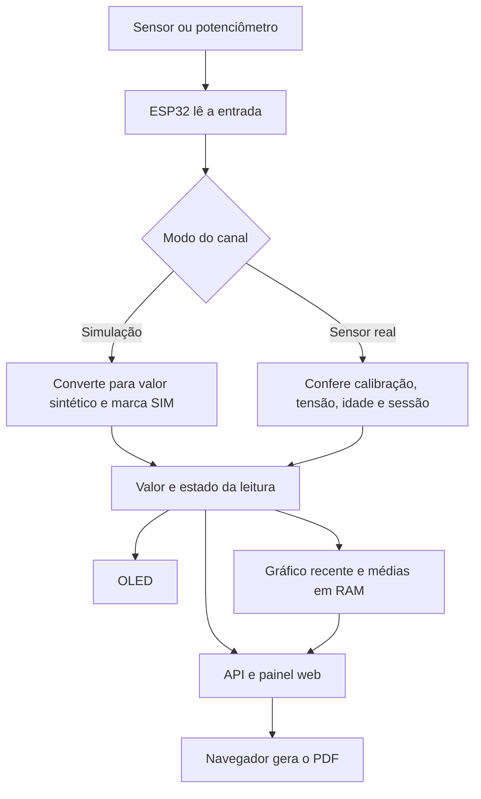

# Como o código funciona

O ESP32 é o pequeno computador do projeto. Ele lê entradas, interpreta os valores, desenha o OLED e entrega uma página ao navegador. Depois de gravado, o programa funciona enquanto a placa recebe energia; a Arduino IDE não precisa ficar aberta.

Para instalar antes de estudar o código, siga [Comece aqui](COMECE_AQUI.md).

## 1. O caminho de uma leitura



Uma leitura não é apenas um número. Ela também tem origem, horário relativo e estado. Isso permite distinguir “pH 7 simulado”, “pH 7 atual” e “pH 7 da última amostra”. Um resultado antigo não deve parecer uma medição nova.

## 2. Onde está cada parte

Todos os arquivos de firmware abaixo ficam em [`firmware/WaterTankMonitor`](../firmware/WaterTankMonitor). Os `.h` são incluídos pelo programa principal durante a compilação; não são aplicativos que você precisa executar separadamente.

| Arquivo | Responsabilidade |
|---|---|
| `WaterTankMonitor.ino` | Coordena inicialização, coleta, OLED, rede, rotas HTTP, comandos e calibração. |
| `Measurement.h` | Define leituras, calibrações e médias; reúne cálculos e verificações compartilhadas. |
| `Settings.h` | Define preferências, valida seus limites e acompanha estabilidade das amostras. |
| `Trend.h` | Define os pontos e a capacidade do gráfico recente. |
| `Panel.h` | Contém o HTML, CSS e JavaScript principal da interface. |
| `Interactions.h` | Contém o JavaScript de gráficos e captura automática de calibração. |
| `Report.h` | Contém o JavaScript que monta o arquivo PDF no navegador. |

Outras pastas:

| Caminho | Conteúdo |
|---|---|
| [`hardware/`](../hardware/README.md) | Circuito, imagens, conexões e lista de materiais. |
| [`simulation/wokwi/`](../simulation/wokwi/README.md) | Demonstração virtual independente, com sensores/controles simulados. |
| [`tests/`](../tests) | Verificações de matemática e comportamento do painel. |
| [`docs/`](../docs) | Instalação, explicações, operação e registros de teste. |
| [`frame/`](../frame) | Modelagem e desenhos da carcaça adicionados pela equipe. |
| [`firmware/platformio.ini`](../firmware/platformio.ini) | Configuração opcional de compilação por linha de comando. |

## 3. `setup()` e `loop()`: ligar e continuar funcionando

No modelo Arduino, `setup()` roda uma vez ao ligar ou reiniciar. Ele prepara os pinos, comunicação com sensores, display, configurações salvas, Wi-Fi e servidor web.

Depois, `loop()` se repete. Ele atende o navegador e o Monitor Serial, controla os horários de coleta, atualiza a tela e fecha as médias do histórico. O código compara o tempo atual com o prazo de cada tarefa, em vez de parar tudo por cinco segundos.

| Tarefa | Ritmo/limite |
|---|---|
| Coleta dos parâmetros | Aproximadamente a cada 5 segundos. |
| Conversão do DS18B20 | Solicitada antes da leitura; espera programada de cerca de 800 ms sem uma pausa longa bloqueante. |
| Redesenho do OLED | Aproximadamente a cada segundo; os valores dependem da coleta. |
| Consulta normal do site | A cada 5 segundos. |
| Média do histórico | Uma por minuto, com contagens por canal. |
| Leitura considerada recente | Até 15 segundos, além das condições do canal. |

Isso permite manter a coleta com o celular desconectado. O servidor HTTP é simples e síncrono; clientes lentos ainda podem atrasar tarefas. A verificação prolongada de carga faz parte dos testes pendentes.

## 4. Como uma tensão vira um valor

### Potenciômetros

O ADC é o conversor analógico-digital: transforma a tensão de um pino em um número. O programa usa resolução de 12 bits, que representa valores de 0 a 4095. No modo simulado, faz uma média de 16 leituras e aplica uma proporção:

```text
fração = leitura_ADC / 4095
pH simulado = fração × 14
turbidez simulada = fração × 100
EC simulada = fração × 2000
```

Por exemplo, uma leitura próxima de 2048 produz aproximadamente pH 7. Esse é um exemplo matemático; a posição física exata do botão pode não corresponder à metade elétrica ideal. Esses números testam interface e fluxo de dados, sem avaliar uma amostra de água.

### Sensores analógicos reais

O programa descarta uma leitura inicial e calcula a média de 16 leituras em milivolts. Em seguida, verifica a faixa elétrica admitida pelo firmware, de 150 a 2300 mV, e a faixa realmente calibrada. Essa faixa de software não elimina a necessidade de proteção elétrica dos GPIOs.

Dois pares de referência definem uma reta: tensão `mv1` corresponde a `y1`; tensão `mv2` corresponde a `y2`. A interpolação é:

```text
valor = y1 + (tensão - mv1) × (y2 - y1) / (mv2 - mv1)
```

Exemplo **didático, não coeficientes para copiar na sonda**: se 1000 mV representam pH 4 e 1600 mV representam pH 7, então 1300 mV representam pH 5,5. A reta também pode ser decrescente. O programa impede pontos inválidos e não extrapola fora do intervalo calibrado.

A turbidez é relativa, em porcentagem; o anúncio comercial do módulo não transforma automaticamente essa leitura em NTU. A estimativa de EC com o módulo TDS também depende de calibração experimental. Não existe uma conversão universal de tensão para esses sensores no projeto.

### Temperatura

O DS18B20 já envia um resultado digital pelo protocolo 1-Wire. `OneWire` faz a comunicação; `DallasTemperature` solicita a conversão e interpreta a resposta. Uma correção constante salva pode ser somada ao valor. Sensor ausente ou inválido gera indisponibilidade, não temperatura inventada.

## 5. Como a calibração guiada ajuda

Calibrar é relacionar a resposta da sua montagem com uma referência conhecida. O usuário fornece a referência; o programa mede a tensão e calcula a relação.

1. O usuário prepara a solução, escolhe o canal, informa seu valor e confirma a preparação.
2. O navegador envia `preparar`, que limpa a janela de estabilidade.
3. A captura automática espera pelo menos 20 segundos e quatro leituras estáveis. Para canais analógicos, a diferença entre maior e menor leitura deve ser no máximo 10 mV.
4. Quando as condições passam, envia a captura uma única vez. Se não estabilizar em três minutos, encerra a tentativa com orientação.
5. O primeiro ponto fica temporariamente em RAM, por até 30 minutos. O segundo ponto exige referências diferentes e pelo menos 20 mV de separação; salva a curva, ainda pendente de verificação.
6. Uma terceira referência intermediária e independente é comparada com uma tolerância informada. Se passar, a curva fica verificada.

EC real também exige temperatura válida de 25 ±0,5 °C. A correção de temperatura usa quatro leituras estáveis com variação de até 0,3 °C e limita o ajuste a ±5 °C; deve ser conferida numa outra temperatura.

O navegador cancela a captura ao mudar referência/canal, perder conexão, detectar reinício ou ir para segundo plano. Isso evita salvar uma referência que o operador já trocou. Depois de uma falha de comunicação, não repete automaticamente uma gravação: a placa pode ter recebido o comando mesmo que a resposta tenha se perdido.

**Estabilidade não é exatidão.** Uma solução errada pode produzir um sinal estável. Enxágue, padrões adequados, tempo de equilíbrio e verificação física continuam necessários. O [manual de operação](OPERACAO.md) descreve esses cuidados.

## 6. Sessões, estados e classificação

pH e EC reais são medidos em sessões temporárias, iniciadas por `amostra 300`, por exemplo. Isso significa acompanhar uma amostra durante cinco minutos. Sem sessão, a leitura anterior pode continuar disponível como última amostra, mas não é considerada atual.

Cada leitura registra valor, tensão, instante, disponibilidade e estado. `isCurrent` verifica as condições para uso como dado real atual. Valores simulados permanecem identificados e não entram na classificação da água.

A classificação experimental exige os quatro parâmetros atuais e as faixas configuradas dos canais analógicos. Três leituras consecutivas fora dos critérios geram indicação de alteração persistente. Essa lógica ajuda a acompanhar mudanças; não declara potabilidade.

## 7. Memória: o que é guardado e onde

| Estrutura | Conteúdo | Ao desligar |
|---|---|---|
| `Reading` | Último resultado e seu estado. | Perdido. |
| `Minute` | Somas, contagens e origem dos valores por minuto. | Perdido. |
| `TrendPoint` | Valores e origem de uma leitura recente. | Perdido. |
| `Calibration` | Dois pontos, verificação e faixas do canal. | Recuperado da NVS. |
| `Settings` | Tema, OLED, simulação e correção de temperatura. | Recuperado da NVS. |
| `CalibrationDraft` | Primeiro ponto ainda não concluído. | Perdido. |

RAM é a memória temporária. NVS é uma área da memória flash usada pela biblioteca `Preferences`, que sobrevive ao desligamento. A senha também fica na NVS. As configurações têm validação e versão; o programa verifica a gravação antes de aplicar a mudança.

O histórico é um **buffer circular** de 1440 minutos: quando enche, a próxima média substitui a mais antiga. Cada canal tem sua própria contagem; ausência de dado não entra como zero. Valores simulados são marcados por canal. São até 24 horas de histórico, não armazenamento permanente.

O gráfico rápido tem outro buffer, de 48 pontos, aproximadamente quatro minutos. Os dois ficam na placa e continuam sendo preenchidos sem navegador aberto. Trocar modo/calibração limpa as séries para não combinar medições com critérios diferentes.

Uma “máscara de bits” é uma forma compacta de guardar vários sim/não em um número. O firmware usa isso para indicar quais canais estão simulados ou disponíveis; o site transforma essa informação em rótulos compreensíveis.

## 8. Como o site funciona dentro do ESP32

`WiFi` cria a rede local; `WebServer` recebe pedidos HTTP. Ao abrir o endereço, o navegador recebe HTML (estrutura), CSS (aparência) e JavaScript (interações). Esses textos ficam no firmware, usando `PROGMEM` para armazenamento em flash.

O site pede dados em JSON, um formato de texto com nomes e valores. Isso evita recarregar a página inteira. Uma API é justamente esse conjunto de endereços e formatos usados para conversar com o programa.

| Endereço | O que entrega |
|---|---|
| `/` | Página principal. |
| `/interactions.js` | Gráficos e captura automática. |
| `/report.js` | Geração do PDF. |
| `/api/readings` | Valores, estados, idade e estabilidade. |
| `/api/settings` | Preferências e situação das calibrações. |
| `/api/history` | Médias por minuto. |
| `/api/trend` | Pontos recentes do gráfico. |
| `/api/command` | Recebe comandos de alteração por POST, com senha e cabeçalho esperado. |

Consultar dados e alterar configurações são operações diferentes. A interface pede a senha para alterações. Ela não é embutida no código nem salva pelo site em armazenamento persistente do navegador. O acesso usa HTTP na rede local, não um serviço remoto HTTPS.

O tema usa variáveis CSS. Os gráficos são desenhados num `canvas`, uma área de desenho do navegador. As preferências editadas permanecem como prévia até salvar; as consultas periódicas não devem sobrescrever escolhas ainda não salvas. Quando os dados param de chegar, o site sinaliza a perda de atualização.

## 9. Como o OLED e os gráficos são desenhados

`Adafruit GFX` desenha numa imagem de 128 × 64 pixels na memória; `Adafruit SSD1306` a envia ao display por I²C. `drawDisplay` escolhe um dos quatro formatos:

- **Lista:** parâmetros organizados em linhas.
- **Grade:** valores distribuídos em áreas da tela.
- **Destaque:** um parâmetro maior.
- **Gráfico:** evolução de um parâmetro escolhido.

O formato é fixo: não há troca automática de páginas. O seletor de parâmetro controla destaque e gráfico. Mínimo e máximo da série definem a escala vertical; a idade dos pontos define a posição horizontal. Dados ausentes e intervalos maiores que 15 segundos não são unidos por uma linha. A marca SIM acompanha dados sintéticos.

## 10. Como o PDF é produzido

O botão reúne uma fotografia dos dados atuais e o histórico. `Report.h` fornece ao navegador um gerador de PDF vetorial: ele escreve textos, caixas, gráficos e tabelas, calculando as páginas necessárias. O navegador cria um arquivo `Blob` e inicia o download.

O trabalho de montar o documento acontece no celular/computador. Não há envio a serviço externo, download de fontes ou biblioteca por CDN. JSON continua sendo o formato interno de transporte; o arquivo entregue ao usuário é PDF.

O relatório identifica dados simulados e inclui todas as médias disponíveis. A data de emissão vem do relógio do navegador; os registros da placa usam tempo relativo, porque ela não mantém um calendário sincronizado. O PDF baixado continua existindo mesmo após o histórico da placa ser apagado.

## 11. O que a simulação Wokwi representa

O arquivo `simulation/wokwi/sketch/sketch.ino` é uma demonstração separada. `diagram.json` descreve os componentes e fios; `libraries.txt` lista dependências; `wokwi.toml` aponta arquivos compilados para o fluxo opcional; `simulation.test.yaml` descreve um cenário de teste.

Ela demonstra entradas, temperatura virtual, OLED e falha pelo botão. **Não é o firmware completo do painel web**, nem comprova a calibração de sensores reais. Para gravar a placa e usar o site, abra o sketch da pasta `firmware/WaterTankMonitor`.

## 12. Como modificar e testar com segurança

| Mudança desejada | Onde começar | O que conferir depois |
|---|---|---|
| Textos, cores ou organização do site | `Panel.h` | Celular, tema claro/escuro e preferências não salvas. |
| Captura automática ou gráficos web | `Interactions.h` | Estabilidade, cancelamento e perda de conexão. |
| Aparência do PDF | `Report.h` | Relatórios vazios, pequenos e com 1440 registros. |
| Desenho do OLED | `drawDisplay` no `.ino` | Quatro formatos, números longos e ausência de dados. |
| Pinagem ou período de leitura | Constantes no `.ino` | Circuito, temporizações, estabilidade e documentação. |
| Estrutura de configuração | `Settings.h` e gravação no `.ino` | Compatibilidade com dados já salvos e reinício. |
| Cálculos de medição | `Measurement.h` e coleta no `.ino` | Pontos extremos, entradas inválidas e referência física. |

Mudar a frequência de coleta também muda o tempo representado por 48 pontos e quatro amostras de estabilidade. Não basta trocar um número sem revisar essas consequências.

[`measurement_compile_test.cpp`](../tests/measurement_compile_test.cpp) verifica regras matemáticas com `static_assert`: uma condição errada impede a compilação. [`dashboard_test.py`](../tests/dashboard_test.py) usa navegador automatizado com respostas simuladas para verificar interações e relatórios. Esses testes não provam precisão das sondas. Veja [como executar e o registro de resultados](TESTES.md).

## Glossário rápido

| Termo | Significado neste projeto |
|---|---|
| Firmware / sketch | Programa gravado no ESP32. |
| GPIO | Pino de entrada/saída da placa, identificado pelo número do sinal. |
| ADC | Conversor de tensão analógica para número. |
| I²C | Comunicação do OLED usando SDA e SCL. |
| 1-Wire | Comunicação do DS18B20 com um fio de dados e alimentação apropriada. |
| EC / µS/cm | Condutividade elétrica / sua unidade usada no painel. |
| Calibração | Relação entre resposta do instrumento e referências conhecidas. |
| NVS / RAM | Configurações persistentes / dados temporários. |
| API / JSON | Interface de comunicação / formato dos dados. |
| Git / GitHub | Histórico de versões / hospedagem compartilhada do repositório. |

As [decisões técnicas](DECISOES.md) explicam por que essas ferramentas foram escolhidas. O [registro de testes](TESTES.md) informa o alcance real da validação.
