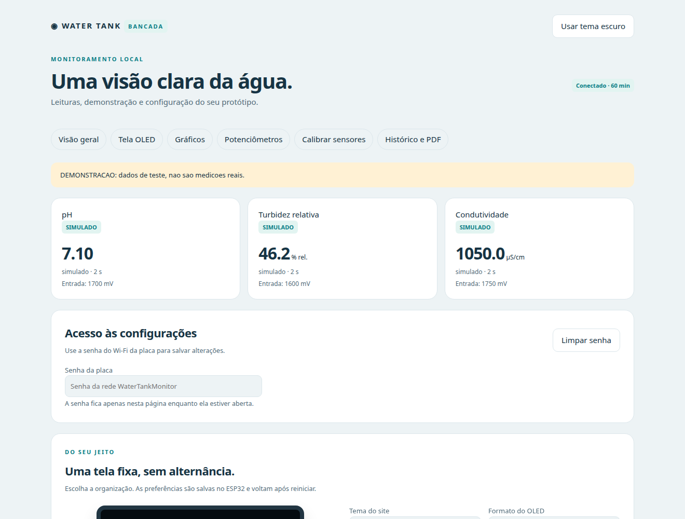

# Painel local

Conecte ao Wi-Fi WaterTankMonitor e abra http://192.168.4.1. O comando Serial `rede` informa a senha. Após atualizar o firmware, recarregue com Ctrl+F5.

## Três cartões

- pH, com duas casas decimais.
- Turbidez relativa, em %.
- Condutividade, em µS/cm, sem compensação térmica.

Cada cartão exibe estado e tensão em mV. A ausência de um sensor não interrompe os demais. Não há mais parâmetro de temperatura no site, nos seletores, no histórico, no OLED ou no PDF.

## Gráficos e OLED

O gráfico mostra uma linha de até 48 amostras, último valor e amplitude (máximo menos mínimo). Lacunas de leituras inválidas não são conectadas. O OLED oferece lista, grade de três campos, destaque e gráfico. Escolha o canal, veja a prévia e salve as preferências.

## Aquisição e conexão

A placa mede continuamente; o período selecionado é apenas um marcador. Fechar o navegador não para a aquisição. Se o Wi-Fi cair, o painel indica dados antigos e tenta reconectar; não confunda isso com uma leitura nova.

## Calibração e relatórios

A senha é necessária para alterações. Siga [Operação](OPERACAO.md) para capturar referências. O histórico acumula médias por minuto; o PDF é gerado localmente no navegador e inclui apenas os três canais atuais. Reiniciar a placa limpa o histórico, mas mantém as calibrações.

## Aparência esperada

Imagem do teste automatizado com dados sintéticos, não leitura da bancada. Mostra os três cartões e as unidades preservadas.
