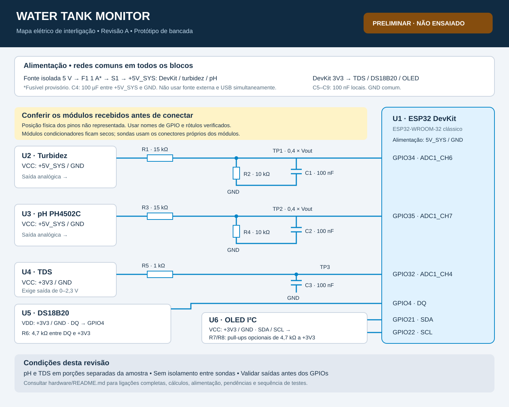

# Circuito — Water Tank Monitor

**Revisão A · Projeto elétrico de referência para bancada · 20/10/2026**

Esta revisão transforma o documento do projeto em ligações elétricas, dimensionamento e roteiro de montagem. Usa uma placa de desenvolvimento com **ESP32-WROOM-32 clássico**, módulos de turbidez e pH, módulo TDS, DS18B20 e OLED I²C.

**Estado: projeto preliminar, ainda não montado nem ensaiado.** A equipe informou os títulos dos anúncios dos cinco sensores/módulos abaixo. Ainda faltam as revisões físicas, a placa ESP32 e o comprimento de cabo selecionado. Antes de conectar os módulos, conferir os itens da seção [Pendências](#11-pendências-para-fechar-a-revisão-de-montagem).

Este material especifica a interligação de módulos prontos. Não é um projeto dos circuitos internos dos sensores, nem contém uma placa de circuito impresso liberada para fabricação.

## Documentos

- Mapa visual das conexões: [SVG vetorial](circuito.svg) · [PNG](circuito.png).
- [Lista de materiais em CSV](bom.csv).
- Esquemas elétricos por estágio, pinagem e sequência de testes: abaixo.

## 1. Arquitetura



Os nomes iguais de rede representam conexões elétricas entre os diagramas. `GND` é comum a todos os circuitos desta revisão. A posição física dos pinos deve ser conferida na placa; os números abaixo são **GPIOs**, não posições no conector.

| Bloco | Referência adotada | Condição para usar este projeto |
|---|---|---|
| U1 — controlador | DevKit com ESP32-WROOM-32 clássico | Entrada de alimentação de 5 V identificada e GPIOs acessíveis. Não aplicar a C3/S3 por semelhança de nome. |
| U2 — turbidez | Módulo analógico de 5 V; SEN0189 como referência elétrica | Confirmar pinagem, modo analógico e faixa da saída do modelo comprado. |
| U3 — pH | PH4502C do documento original | Confirmar revisão, alimentação, saída analógica e consumo com o fornecedor. |
| U4 — TDS | SEN0244 como referência elétrica | Aceitar alimentação de 3,3 V e saída de 0 a 2,3 V. Um clone precisa ser verificado. |
| U5 — temperatura | DS18B20 de três fios | Identificar VDD, DQ e GND; não confiar somente na cor dos fios. |
| U6 — display | Módulo OLED SSD1306, I²C, quatro pinos | Aceitar alimentação e sinais de 3,3 V; verificar pull-ups do módulo. |

As especificações SEN0189 e SEN0244 vêm da DFRobot e não certificam módulos de terceiros. Para o PH4502C, não foi identificado um datasheet primário da unidade comprada.

### Componentes informados pela equipe

| Item comprado, conforme título do anúncio | Consequência para o circuito |
|---|---|
| Kit de turbidez “0–1000 NTU”, 5 V, saídas digital e analógica | Usar a saída analógica com divisor. A faixa anunciada em NTU não estabelece uma calibração válida do conjunto. |
| OLED branco 0,96", 128×64, IIC/I²C, SSD1306 | Compatível com a arquitetura proposta; confirmar alimentação de 3,3 V e pull-ups na placa recebida. |
| DS18B20 encapsulado, cabo de três fios | O anúncio lista 1, 2, 3, 5 e 10 m; falta identificar a variante comprada. R6 é o ponto inicial para bancada, não uma validação para qualquer comprimento. |
| TDS V1.0 analógico, anunciado como condutividade | Conferir alimentação e saída da unidade; a especificação do SEN0244 é apenas referência, não identificação do fabricante deste módulo. |
| PH4502C, pH 0–14, com eletrodo BNC | Família confirmada pelo título; conferir rótulos e características da revisão recebida. |

Os títulos não informam todas as características elétricas necessárias nem substituem a inspeção da unidade. Não foram incluídos dados da conta ou dos pedidos no repositório.

## 2. Alimentação

Adotar uma fonte externa **regulada e isolada de 5 V / 3 A**, como previsto no documento, com distribuição em borne/adaptador apropriado. O circuito opera somente no lado de baixa tensão; a fonte deve permanecer fora da área molhada.

```text
Fonte externa 5 V
 positivo ── F1 ── S1 ── +5V_SYS ──┬── U1 entrada 5V da DevKit
                                   ├── U2 VCC turbidez
                                   ├── U3 VCC pH
                                   └── C4 (+)
 negativo ─────────────── GND ────────── C4 (-)

U1 regulador integrado ── +3V3 ─────┬── U4 VCC TDS
                                   ├── U5 VDD DS18B20
                                   ├── U6 VCC OLED
                                   └── resistores pull-up

C4 = 100 µF / 16 V entre +5V_SYS e GND, respeitando polaridade.
F1 = fusível 1 A de ação retardada, provisório, com porta-fusível.
S1 = chave liga/desliga com capacidade de pelo menos 1 A em 5 Vcc.
```

F1 deve ser confirmado após medir corrente de partida e funcionamento. Escolher fusível, cabos, conectores e chave de forma coordenada; os 3 A da fonte não são o consumo esperado do circuito. Para a bancada, usar condutores curtos de alimentação e evitar passar a corrente de toda a montagem por um único jumper fino.

**Não conectar a fonte externa à DevKit ao mesmo tempo que o USB do computador.** O fabricante da DevKitC especifica opções de alimentação mutuamente exclusivas. Para gravar pela USB nesta revisão: desligar a fonte, desconectar o chicote completo da DevKit, gravar somente a placa, remover o USB e então reconectar a montagem com tudo desligado. Isso também evita alimentar a placa pelos sinais dos sensores. [Guia da DevKitC](https://documentation.espressif.com/esp-dev-kits/en/latest/esp32/esp32-devkitc/user_guide.html)

O uso do regulador de 3,3 V da DevKit depende da placa real e da margem de corrente/temperatura disponível. Medir a linha com Wi-Fi e display ativos. Se houver queda de tensão ou aquecimento excessivo, revisar a alimentação com um regulador dedicado; não ligar duas saídas de reguladores em paralelo.

Adicionar C5–C9, **100 nF cerâmicos / 16 V ou mais**, entre VCC e GND junto aos conectores de U2–U6, um por módulo. São desacoplamentos locais adicionais.

## 3. Turbidez e pH: entradas analógicas

Usar um circuito separado para cada saída:

```text
U2 OUT analógica ── R1 15 kΩ ──┬── TP1 ── GPIO34 / ADC1_CH6
                              ├── R2 10 kΩ ── GND
                              └── C1 100 nF ─ GND

U3 OUT analógica ── R3 15 kΩ ──┬── TP2 ── GPIO35 / ADC1_CH7
                              ├── R4 10 kΩ ── GND
                              └── C2 100 nF ─ GND
```

R1–R4: resistores de 1%, ¼ W. C1/C2: cerâmicos. Montar os capacitores e resistores inferiores perto da DevKit. Não conectar saída digital nem pino de temperatura do módulo pH às entradas deste esquema. Identificar a saída analógica na documentação da unidade recebida.

### Dimensionamento

```text
V_ADC = V_OUT × 10 / (15 + 10) = 0,4 × V_OUT
V_OUT estimada = 2,5 × V_ADC

Saída de 4,5 V → entrada de 1,80 V
Saída de 5,0 V → entrada de 2,00 V
Saída de 5,25 V → entrada nominal de 2,10 V

Pior razão com resistores de 1%:
10,1 / (14,85 + 10,1) ≈ 0,40481
5,25 V × 0,40481 ≈ 2,125 V

Resistência de Thévenin = 15 kΩ || 10 kΩ = 6 kΩ
Constante de tempo RC = 6 kΩ × 100 nF = 0,6 ms
Frequência de corte aproximada = 265 Hz
```

**Alteração em relação ao documento inicial:** o divisor de 10 kΩ + 10 kΩ foi substituído por 15 kΩ + 10 kΩ. Assim, há mais margem na região útil do ADC para saídas próximas de 5 V. A Espressif documenta redução de precisão acima de aproximadamente 2,45 V no ESP32 clássico na maior atenuação. A faixa próxima de zero também exige validação. [ADC do ESP32](https://docs.espressif.com/projects/esp-idf/en/v4.4.8/esp32/api-reference/peripherals/adc.html)

O SEN0189 de referência opera em 5 V e informa saída analógica de até 4,5 V. [Especificação DFRobot](https://wiki.dfrobot.com/sen0189/)

O cálculo pressupõe uma saída capaz de alimentar a carga de 25 kΩ do divisor. Comparar a tensão com e sem o divisor; se houver alteração relevante, será necessário um buffer ou outra interface. O divisor reduz a tensão nominal, mas não é proteção contra qualquer falha, sobretensão ou descarga eletrostática.

## 4. TDS: entrada analógica

```text
+3V3 ───────────────────────── U4 VCC
GND ────────────────────────── U4 GND
U4 A / OUT ── R5 1 kΩ ──┬──── TP3 ── GPIO32 / ADC1_CH4
                       └──── C3 100 nF ── GND
Sonda TDS ──────────────────── conector próprio de U4
```

Para o **SEN0244**, o fabricante informa alimentação de 3,3–5,5 V, consumo de 3–6 mA e saída de 0–2,3 V. Por isso não há divisor nesta entrada. Se o módulo comprado não respeitar essa saída, este estágio precisa ser redesenhado. R5 não torna uma saída de 5 V compatível com o ESP32. [Especificação DFRobot](https://wiki.dfrobot.com/sen0244)

O filtro tem constante de tempo nominal de 0,1 ms, desconsiderando a impedância da saída. Validar sua resposta com o módulo real.

**TDS e condutividade não são a mesma grandeza.** Não rotular a leitura como EC em µS/cm sem estabelecer e validar uma conversão para o módulo e a solução usados. Até lá, registrar tensão e estado “não calibrado”. A troca por um módulo EC dedicado exige revisar alimentação, saída e calibração.

## 5. Temperatura: DS18B20

```text
+3V3 ────────────────┬──────── U5 VDD
                    └── R6 4,7 kΩ ──┐
GPIO4 ──────────────────────────────┴── U5 DQ
GND ─────────────────────────────────── U5 GND
```

Usar alimentação externa de três fios, sem modo parasita. O DS18B20 aceita 3,0–5,5 V; o pull-up do barramento deve acompanhar os 3,3 V do ESP32. [Datasheet Analog Devices](https://www.analog.com/media/en/technical-documentation/data-sheets/ds18b20.pdf)

O encapsulamento à prova d'água e o cabo dependem do fornecedor da sonda. Conferir sua pinagem. Começar com cabo curto e validar comunicação/CRC antes de ampliar o comprimento.

## 6. Display OLED

```text
+3V3 ───────────────────────── U6 VCC
GND ────────────────────────── U6 GND
GPIO21 ─────────────────────── U6 SDA
GPIO22 ─────────────────────── U6 SCL

+3V3 ── R7 4,7 kΩ ── SDA     [montar somente se necessário]
+3V3 ── R8 4,7 kΩ ── SCL     [montar somente se necessário]
```

Confirmar que se trata de módulo I²C de quatro pinos e que ele funciona em 3,3 V. Verificar os resistores já existentes: não adicionar automaticamente R7/R8 em paralelo aos pull-ups do módulo. Em repouso, SDA/SCL devem ficar próximas de 3,3 V, nunca puxadas a 5 V. O endereço será identificado no teste; não foi fixado no projeto.

Manter o display junto da placa. Esta revisão não dimensiona um barramento I²C remoto até o interior da residência.

## 7. Tabela de montagem

| Origem | Destino | Rede / observação |
|---|---|---|
| Fonte positiva | F1 → S1 → distribuição | +5V_SYS |
| Fonte negativa | Barra comum | GND |
| +5V_SYS | U1 entrada 5 V, U2 VCC, U3 VCC | Confirmar a entrada da DevKit |
| U1 3V3 | U4 VCC, U5 VDD, U6 VCC | +3V3 |
| GND | U1, U2, U3, U4, U5 e U6 | Referência comum |
| U2 saída analógica | R1 | Nunca direto no GPIO |
| R1 terminal restante | R2, C1 e GPIO34 | TP1; R2/C1 terminam em GND |
| U3 saída analógica | R3 | Nunca direto no GPIO |
| R3 terminal restante | R4, C2 e GPIO35 | TP2; R4/C2 terminam em GND |
| U4 saída analógica | R5 | Confirmar máximo de 2,3 V |
| R5 terminal restante | C3 e GPIO32 | TP3; C3 termina em GND |
| U5 DQ | GPIO4 e R6 | Outro terminal de R6 em +3V3 |
| U6 SDA | GPIO21 | Pull-up a +3V3 |
| U6 SCL | GPIO22 | Pull-up a +3V3 |
| C4 positivo / negativo | +5V_SYS / GND | Capacitor polarizado |
| C5–C9 | VCC / GND de U2–U6 | Um capacitor por módulo |

Conectar sondas de pH, turbidez e TDS somente aos seus módulos condicionadores. Nenhum eletrodo deve ir diretamente ao ESP32. As saídas não usadas ficam desconectadas.

## 8. Organização física

- Separar alimentação, entradas analógicas e display em regiões identificadas da bancada.
- Levar os retornos dos sensores à distribuição de GND, evitando compartilhar trechos longos com a corrente do controlador.
- Manter conexões analógicas curtas; passar sinal junto ao respectivo GND.
- Manter a antena da DevKit afastada de fios, módulos, superfícies metálicas e água.
- Fixar os conectores e identificar cada cabo nas duas extremidades.
- Manter módulos, BNC e emendas secos; imergir somente as partes das sondas permitidas pelos fabricantes.
- Usar porções separadas da mesma coleta para pH e TDS. Esta revisão tem GND comum e **não possui isolamento galvânico entre sondas**.
- Verificar se as barras da protoboard são interrompidas ao meio antes de distribuir a alimentação.

Não foram previstos bomba, relé, válvula ou controle de nível, pois não fazem parte do escopo documentado.

## 9. Requisitos para o firmware futuro

Esta seção define a interface elétrica, sem escolher linguagem, bibliotecas ou framework.

1. Usar ADC1 nos GPIOs 34, 35 e 32, preservando operação com Wi-Fi.
2. Configurar atenuação apropriada para até 2,3 V no ESP32 clássico e conversão calibrada para tensão; não pressupor `ADC × 3,3 / 4095` como medida exata.
3. Ao alternar canais, permitir estabilização e descartar a primeira amostra se os ensaios indicarem necessidade; avaliar médias/múltiplas amostras.
4. Aplicar o fator nominal 2,5 somente às entradas de turbidez e pH, substituindo-o pela razão medida dos resistores quando disponível.
5. Calibrar o conjunto completo — sonda, módulo, divisor e ADC — e registrar temperatura e dispersão.
6. Não transformar a tensão de turbidez em NTU sem validação da curva, nem a saída TDS em EC por uma constante presumida.
7. Tratar dados antigos, saturação, falhas de comunicação e calibração ausente.
8. Uma entrada analógica desconectada pode produzir uma tensão plausível; não prometer detecção universal de falha somente pela leitura.

## 10. Primeira energização e ensaios

| Etapa | Procedimento | Critério / registro |
|---|---|---|
| 1 — sem energia | Conferir polaridade, componentes e continuidade das redes. | Não haver curto franco entre alimentação e GND; capacitor pode carregar durante a medição. |
| 2 — fonte isolada | Medir a saída antes de conectar qualquer módulo. | Meta de projeto: 4,75–5,25 V. |
| 3 — placa | Energizar somente a DevKit, sem USB. | Confirmar 3,3 V estáveis, partida e ausência de aquecimento anormal. |
| 4 — módulos | Desligar, adicionar um módulo por vez e medir consumo. | Registrar consumo e tensão de cada linha; confirmar margem do regulador. |
| 5 — analógicos desconectados do ESP32 | Montar divisores/filtros; medir TP1–TP3 com multímetro. | TP1/TP2 coerentes com 0,4 × saída; TP3 dentro de 0–2,3 V. |
| 6 — carga do divisor | Comparar saída de U2/U3 com e sem carga de 25 kΩ. | Registrar desvio; se relevante para o ensaio, revisar interface. |
| 7 — conexão dos GPIOs | Desligar antes de conectar; ligar novamente e conferir leituras. | Tensões medidas e convertidas devem concordar dentro do erro documentado. |
| 8 — digitais | Testar DS18B20 e OLED individualmente. | Comunicação estável; pull-ups em 3,3 V. |
| 9 — Wi-Fi | Comparar leituras com rádio ativo e inativo. | Registrar ruído, deriva e qualquer reinicialização. |
| 10 — calibração | Usar referências adequadas e três repetições por condição. | Registrar método, valores, temperatura e limitações. |
| 11 — funcionamento | Ensaiar 24 h da eletrônica e display; identificar sessões com sondas. | Sem resets não explicados; histórico/calibração conforme requisitos. |

O multímetro não revela todos os transientes: se houver reinicializações ou ruído persistente, inspecionar alimentação e entradas com osciloscópio. As margens calculadas não substituem testes.

## 11. Pendências para fechar a revisão de montagem

- [x] Títulos dos anúncios dos cinco módulos/sensores recebidos da equipe.
- [ ] Link público ou fotos legíveis para conferir fabricante, revisão e pinagem de cada módulo.
- [ ] Revisão e esquema da DevKit; identificação de 5 V, 3V3 e capacidade do regulador.
- [ ] Pinagem e faixa de saída do PH4502C e do módulo de turbidez.
- [ ] Confirmação de alimentação/saída do TDS e definição de como validar EC.
- [ ] Compatibilidade em 3,3 V e pull-ups do OLED.
- [ ] Pinagem das sondas encapsuladas.
- [ ] Corrente total, partida, fusível e temperatura do regulador medidos.
- [ ] Faixa das saídas e efeito da carga dos divisores medidos.

**Para uma PCB:** somente depois dessas confirmações definir conectores, dimensões, footprints e fixação. Esta revisão não contém arquivos Gerber ou validação ERC/DRC e não deve ser tratada como placa pronta para encomenda.

## Referências

O escopo foi extraído do documento local “Water tank monitor.md”. As decisões de dimensionamento desta revisão estão identificadas no texto.

- [Espressif — DevKitC e alimentação](https://documentation.espressif.com/esp-dev-kits/en/latest/esp32/esp32-devkitc/user_guide.html).
- [Espressif — ADC, calibração, atenuação e ruído](https://docs.espressif.com/projects/esp-idf/en/v4.4.8/esp32/api-reference/peripherals/adc.html).
- [DFRobot — turbidez SEN0189](https://wiki.dfrobot.com/sen0189/).
- [DFRobot — TDS SEN0244](https://wiki.dfrobot.com/sen0244).
- [Analog Devices — DS18B20](https://www.analog.com/media/en/technical-documentation/data-sheets/ds18b20.pdf).
